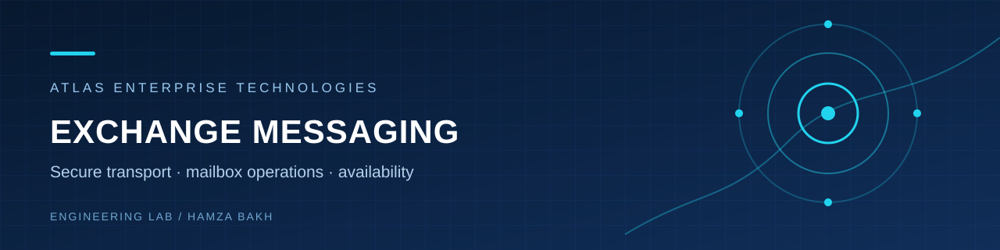
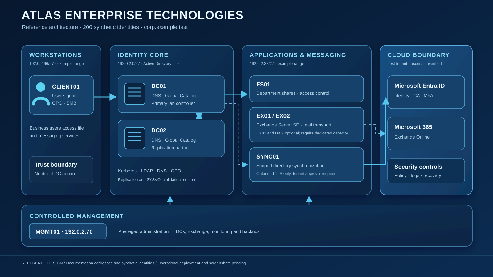
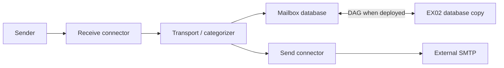

# Enterprise Exchange Messaging Lab

**Atlas Enterprise Technologies · Hamza Bakh · Messaging Infrastructure portfolio**

> **IMPLEMENTED/TESTED:** offline synthetic message-route analyzer and tests. **DOCUMENTED ONLY:** Exchange Server SE deployment, operational commands and runbooks. **SIMULATED:** route findings. **BLOCKED:** Exchange installation, mail delivery, DAG and live screenshots.

## Project overview and business problem

A 200-person fictional enterprise needs dependable email, secure transport, recoverable mailboxes and defensible hybrid choices. This project designs a supported Exchange Server Subscription Edition environment and supplies a local diagnostic model. No mail has been sent by this repository.

## Engineering objectives

Define a supported build, least-privilege transport configuration, quota and certificate monitoring, message tracing, high availability and recovery validation. [Architecture](ARCHITECTURE.md) ties EX01/optional EX02 to the shared [reference environment](ARCHITECTURE_OVERVIEW.md).

## Architecture overview and diagram

This editable SVG is the reference design; its Exchange nodes show the intended topology, not deployed servers or delivered mail.

Editable [messaging flow](assets/diagrams/messaging-flow.mmd) and [full architecture](ARCHITECTURE.md).

## Technology stack and infrastructure requirements

Exchange Server SE on a currently supported Windows Server build, AD DS, DNS, TLS PKI, PowerShell 5.1 in Exchange Management Shell, application-aware backup, Python 3 for offline modeling. Verify the [Microsoft supportability matrix](https://learn.microsoft.com/en-us/exchange/plan-and-deploy/supportability-matrix) and [system requirements](https://learn.microsoft.com/en-us/exchange/plan-and-deploy/system-requirements) again before deployment. Exchange 2016/2019 are historical interview topics; their support ended in 2025.

## Security architecture

Restrict relay, use valid certificates and TLS, scope RBAC, audit mailbox delegation, protect admin paths and backups. See [security review](SECURITY.md).

## Installation and configuration walkthrough

[Prerequisites](PREREQUISITES.md), [deployment](DEPLOYMENT.md), and [20-module configuration plan](docs/configuration/CONFIGURATION.md) are designed for a separate adequately sized lab. The current host cannot support a credible Exchange/DAG deployment.

## Automation examples

`python scripts/automation/message_route.py --config examples/synthetic-data/topology.json --sender lab.alice@atlas.example.test --recipient external@example.org --date 2026-10-21` produces a **simulated configuration analysis**. `scripts/monitoring/Get-ExchangeHealth.ps1` is a read-only live example and was not run.

## Screenshots and verified evidence

No Exchange interface or delivery screenshot was captured because Exchange is not installed. The local [unit-test command output](tests/evidence/unittest.txt), [PowerShell parser output](tests/evidence/parser.txt), [validation report](VALIDATION_REPORT.md), and [GitHub Actions run](https://github.com/Hamzabakh1/enterprise-exchange-messaging-lab/actions) provide authentic **offline** evidence. See the [screenshot manifest](SCREENSHOT_MANIFEST.md) for the missing operational captures and the [capture workflow](SCREENSHOT_AUTOMATION.md) for the procedure.

## Testing methodology

Unit tests exercise healthy, quota, queue, TLS, connector, service, database and DAG branches in the synthetic model. Exchange integration and mail-flow validation remain blocked. See [testing](TESTING.md).

## Troubleshooting scenarios and disaster recovery

[Eight runbooks](TROUBLESHOOTING.md) include send, receive, quota, queue, TLS, service, database and DAG incidents. [Recovery plan](docs/recovery/RECOVERY.md) distinguishes mailbox, database and site failures.

## Lessons learned and engineering trade-offs

Transport observability requires message IDs and timestamps, not just an SMTP test. DAGs increase availability but add quorum and storage demands; they do not replace backups. A passing local route model says only that selected synthetic fields are internally consistent.

## Technical interview talking points

Defend the difference between SMTP acceptance and mailbox delivery, certificate/service binding, RBAC scopes, database copy activation, and hybrid routing. See [French preparation](INTERVIEW_PREPARATION_FR.md).

## Future improvements

Deploy Exchange SE on supported dedicated capacity, add real tracking logs, test restore and DAG failover, capture authentic screenshots, and run PSScriptAnalyzer after installing it.
